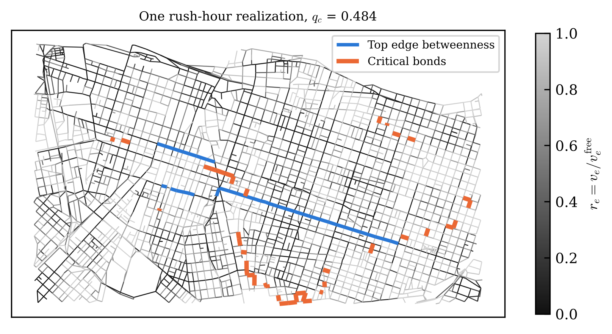
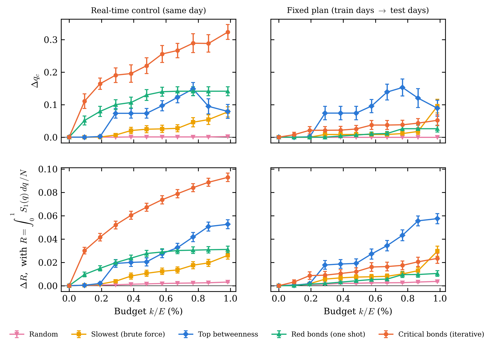
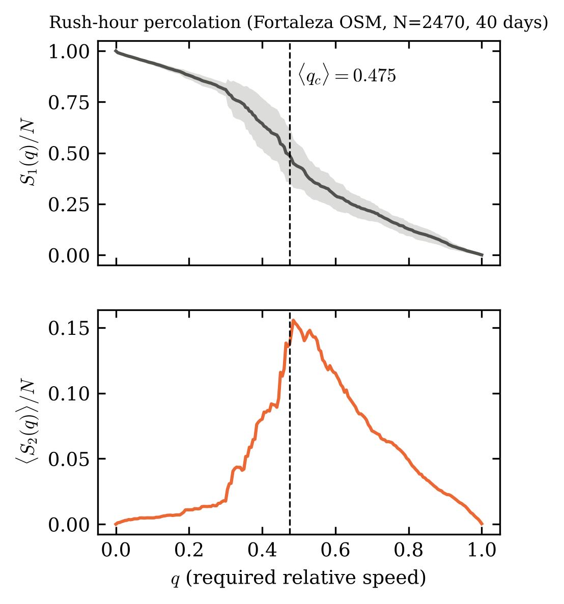
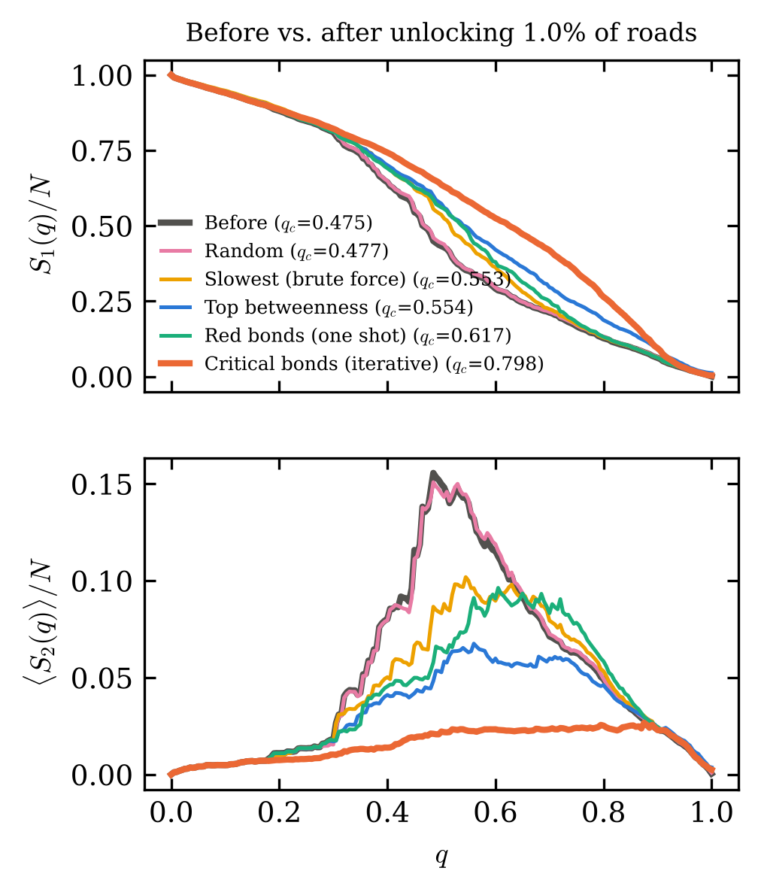

# Transições de Fase de Percolação Dinâmica e Gargalos Críticos na Malha Viária de Fortaleza

Protótipo de pesquisa em física estatística de redes complexas aplicada ao trânsito urbano.
Ponto de partida: o protocolo de percolação de tráfego de Li *et al.* (PNAS **112**, 669, 2015), adaptado para uma pergunta de **otimização**:

> Se a cidade só pode intervir em **menos de 1% das vias** (semáforo, faixa exclusiva, fiscalização), **quais** vias escolher para que a malha continue conectada mesmo exigindo velocidades altas?

**Ideia central.** Cada via $e$ tem velocidade relativa $r_e = v_e/v_e^{\rm livre}$. No nível de exigência $q$, a via está aberta se $r_e \ge q$. Subindo $q$, o componente gigante $S_1(q)$ colapsa em $q_c$, onde o segundo maior cluster $S_2(q)$ tem seu pico. Quanto **maior** $q_c$, mais resiliente é a cidade. No ponto crítico, o cluster gigante é segurado por poucas *red bonds*, e são elas que devem ser consertadas.

---

## Índice Mestre do Projeto

| Frente | Entregável | Status |
|---|---|---|
| **1. Pipeline computacional** | 1.1 Malha real do OSM (corredor Benfica–Centro–Aldeota) | ✅ `codigo/otimizacao_antes_depois.py` |
| | 1.2 Modelo de velocidades no rush (BPR + carga ~ betweenness + desordem congelada e recozida, espacialmente correlacionada) | ✅ |
| | 1.3 Varredura de percolação: $S_1(q)$, $S_2(q)$, $q_c$ exato (Newman–Ziff) e robustez $R$ | ✅ |
| | 1.4 Caçador de red bonds vs. edge betweenness | ✅ |
| | 1.5 Intervenção "antes vs. depois" (5 estratégias, tempo real e plano fixo) | ✅ |
| | 1.6 Análise de tamanho finito (recortes de tamanhos diferentes) | ⏳ próximo módulo |
| | 1.7 Grafo direcionado (componentes fortemente conexos, mão única) | ⏳ |
| | 1.8 Reroteamento dinâmico (equilíbrio de Wardrop) | ⏳ |
| **2. Artigo (preprint)** | *Percolation-Driven Bottleneck Optimization in Urban Traffic Networks: A Case Study in Fortaleza* | ⏳ |
| **3. Handouts (LaTeX)** | Teoria: [T1](handouts/pdf/T1_percolacao.pdf), [T2](handouts/pdf/T2_espectral.pdf), [T3](handouts/pdf/T3_kcore_betweenness.pdf), [T4](handouts/pdf/T4_tamanho_finito.pdf), [T5](handouts/pdf/T5_fisica_trafego.pdf), [T6](handouts/pdf/T6_redes_dirigidas.pdf) | ✅ |
| | Projeto: [P1](handouts/pdf/P1_modelo.pdf), [P2](handouts/pdf/P2_algoritmos.pdf), [P3](handouts/pdf/P3_resultados.pdf) | ✅ |
| **4. Sabatina** | Perguntas no estilo do Prof. José Soares ao fim de cada módulo | em andamento |

**Próximos passos:** veja o [Plano de Melhorias](PLANO_MELHORIAS.md).

### Handouts

Cada handout tem teoria, Ideias em destaque, exemplos resolvidos e problemas com pontuação. As soluções completas ficam no final.

| | Tema | Problemas |
|---|---|---|
| [**T1**](handouts/pdf/T1_percolacao.pdf) | Percolação, $p_c$, expoentes críticos, tamanho finito, $S_2$, red bonds | 10 (29 pts) |
| [**T2**](handouts/pdf/T2_espectral.pdf) | Funções geradoras, Molloy–Reed, espectro de $A$, matriz de Hashimoto | 9 (25 pts) |
| [**T3**](handouts/pdf/T3_kcore_betweenness.pdf) | $k$-cores, betweenness, controle de transições | 8 (19 pts) |
| [**T4**](handouts/pdf/T4_tamanho_finito.pdf) | Escala de tamanho finito, ajustes, bootstrap, colapso de dados | 7 (17 pts) |
| [**T5**](handouts/pdf/T5_fisica_trafego.pdf) | Diagrama fundamental, ondas de choque, Wardrop, Braess, MSA | 6 (15 pts) |
| [**T6**](handouts/pdf/T6_redes_dirigidas.pdf) | Redes dirigidas, SCCs, gravata-borboleta, mão única em Fortaleza | 6 (15 pts) |
| [**P1**](handouts/pdf/P1_modelo.pdf) | O modelo de velocidades, equação por equação | 8 (18 pts) |
| [**P2**](handouts/pdf/P2_algoritmos.pdf) | Os algoritmos por dentro: union-find, varredura, pontes, validação | 8 (17 pts) |
| [**P3**](handouts/pdf/P3_resultados.pdf) | Resultados em Fortaleza, limitações e roteiro de defesa | 4 (12 pts) |

Os fontes `.tex` estão em `handouts/teoria/` e `handouts/projeto/`. Para recompilar: `bash handouts/compilar.sh` (precisa de TeX Live com `latexmk`).

---

## Como rodar

```bash
pip install -r requirements.txt
python codigo/teste_algoritmos.py                  # confere os algoritmos contra força bruta
python codigo/otimizacao_antes_depois.py           # baixa a malha via Overpass (precisa de internet)
python codigo/otimizacao_antes_depois.py --sintetico   # malha sintética, sem internet
```

**Se o Overpass estiver fora do ar**, use um extrato do OpenStreetMap e recorte localmente (precisa do `osmium-tool`):

```bash
curl -O https://download.openstreetmap.fr/extracts/south-america/brazil/northeast/ceara-latest.osm.pbf
bash codigo/recortar_osm.sh ceara-latest.osm.pbf dados/osm/corredor.osm
python codigo/otimizacao_antes_depois.py --osm-xml dados/osm/corredor.osm
```

Opções: `--dias` (realizações do rush, padrão 40), `--orcamento` (fração máxima de vias destravadas, padrão 0,01), `--semente`. A malha fica guardada em `dados/` (cache, não versionado). As figuras vão para `figuras/`, com prefixo `fortaleza_` ou `sintetico_`.

## Estrutura

```
codigo/
  otimizacao_antes_depois.py   pipeline completo (seções 0-7, comentadas)
  teste_algoritmos.py          testes contra força bruta
  recortar_osm.sh              recorte do extrato .osm.pbf (alternativa ao Overpass)
handouts/
  estilo/handout.sty           estilo comum
  teoria/  projeto/            fontes .tex
  pdf/                         PDFs compilados
  compilar.sh
figuras/                       saídas do script
resultados/saida_fortaleza.txt saída completa da rodada em Fortaleza
```

## O modelo em 6 equações

1. Fluxo livre: $t_e^0 = \ell_e / v_e^{\rm CTB}$ (velocidades do Código de Trânsito: 60 arterial, 40 coletora, 30 local).
2. Carga estrutural: $b_e$ = edge betweenness com pesos $t_e^0$, normalizada para $\langle b \rangle = 1$.
3. Carga no rush: $x_e = D\,(x_0 + b_e/c_e)\,\exp(\sigma_e \eta_e - \sigma_e^2/2)$, com $\sigma_e = \sigma(1 + \kappa\,\mathbb{1}_{\rm arterial})$.
4. Ruído: $\eta_e = \sqrt{\psi}\,\eta_e^{\rm crônico} + \sqrt{1-\psi}\,\eta_e^{\rm dia}$, cada parte um campo gaussiano suavizado por difusão na rede.
5. Velocidade (função BPR): $r_e = 1/(1 + \alpha x_e^{\beta})$, com $\alpha = 0{,}15$ e $\beta = 4$.
6. Percolação: aberta se $r_e \ge q$; $q_c = \arg\max_q S_2(q)$; $R = \int_0^1 S_1(q)\,dq / N$.

## Resultados em Fortaleza

Malha real do OpenStreetMap: 2470 cruzamentos, 4166 vias. **As velocidades são simuladas** pelo modelo acima, com 40 dias de rush e orçamento de 41 vias (0,98%).

| Estratégia | $\Delta q_c$ tempo real | $\Delta R$ tempo real | $\Delta R$ plano fixo |
|---|---|---|---|
| Aleatória | +0,002 ± 0,001 | +0,003 ± 0,001 | +0,004 ± 0,001 |
| Vias mais lentas (força bruta) | +0,078 ± 0,016 | +0,026 ± 0,003 | +0,030 ± 0,004 |
| Maior edge betweenness | +0,079 ± 0,021 | +0,053 ± 0,004 | **+0,057 ± 0,004** |
| Red bonds (uma vez) | +0,141 ± 0,014 | +0,031 ± 0,003 | +0,011 ± 0,002 |
| **Ligações críticas (iterativo)** | **+0,323 ± 0,023** | **+0,093 ± 0,004** | +0,023 ± 0,004 |

(± = erro padrão da média sobre os dias.) Antes da intervenção: $\langle q_c\rangle = 0{,}475$ e $\langle R\rangle = 0{,}489$.

- **Controle em tempo real:** destravar as ligações críticas sobe $q_c$ de 0,475 para ≈ 0,80, cerca de 4× o ganho do betweenness ou da força bruta. Em $R$, o ganho é 1,8× o do betweenness ($7{,}6\sigma$) e 3,6× o da força bruta.
- **Os gargalos não são as vias importantes do mapa:** sobreposição zero com as 41 vias de maior betweenness. A criticidade é uma propriedade da rede *congestionada*.
- **Os gargalos evoluem:** a sobreposição entre dias consecutivos é 0,033 (≈ 7× o acaso). Num plano fixo, vence o betweenness, que ataca o corredor cronicamente saturado (Rua Padre Valdevino, Av. Duque de Caxias, Av. Domingos Olímpio). Implicação: o ganho grande exige **controle semafórico adaptativo** (CTAFOR/AMC).




| | |
|---|---|
|  |  |

As figuras da malha sintética (`figuras/sintetico_*`) continuam no repositório para comparação. O handout P3 discute as diferenças.

## Limitações conhecidas

- Velocidades **simuladas**. O próximo salto é calibrar com dados reais (GPS de ônibus da Etufor ou dados da AMC).
- Grafo **não-direcionado** (conectividade fraca). 72% das ruas do corredor são de mão única, e respeitando os sentidos o limiar cai de q_c ≈ 0,48 para ≈ 0,25 (handout T6). É a prioridade da Fase 2 do plano.
- Carga por betweenness em fluxo livre, **sem reroteamento** (sem equilíbrio de Wardrop). Isso concentra a carga em um único corredor.
- $q_c$ de uma única amostra não é monótono sob melhorias (handout T1, Problema 7). Por isso também reportamos $R$.

## Referências principais

- D. Li *et al.*, PNAS **112**, 669 (2015).
- C. M. Schneider, A. A. Moreira, J. S. Andrade Jr., S. Havlin, H. J. Herrmann, PNAS **108**, 3838 (2011).
- M. E. J. Newman & R. M. Ziff, Phys. Rev. Lett. **85**, 4104 (2000).
- B. Karrer, M. E. J. Newman & L. Zdeborová, Phys. Rev. Lett. **113**, 208702 (2014).
- D. Stauffer & A. Aharony, *Introduction to Percolation Theory* (1994).

Dados de mapa © colaboradores do OpenStreetMap, licença ODbL.
