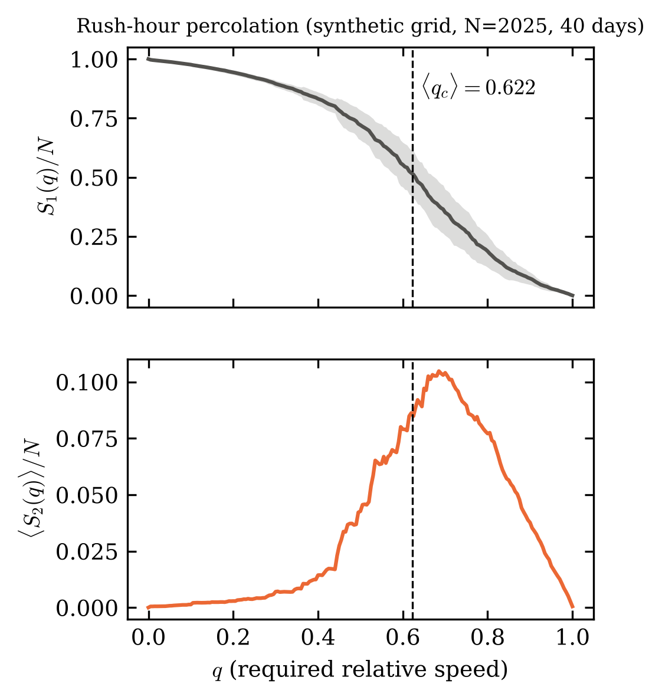
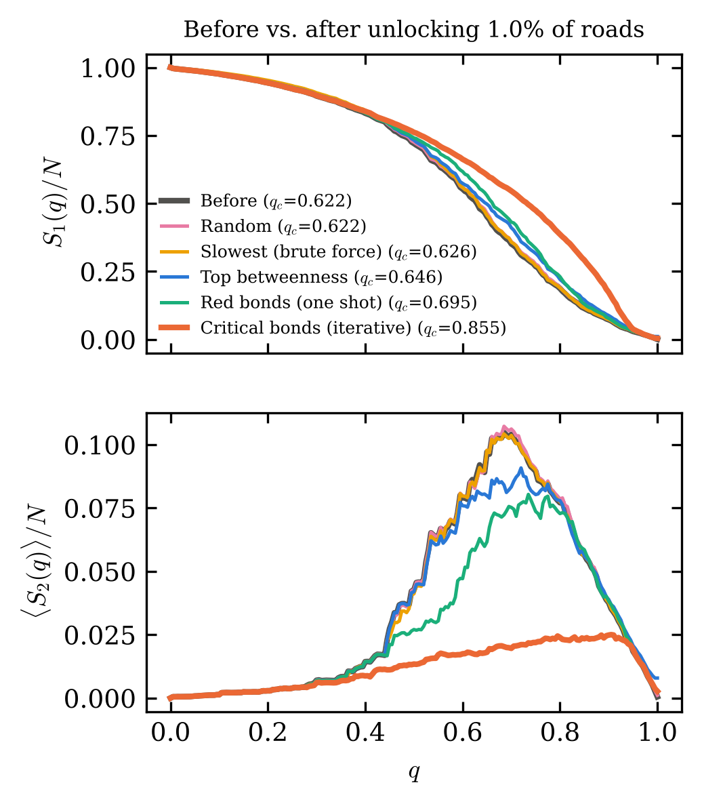
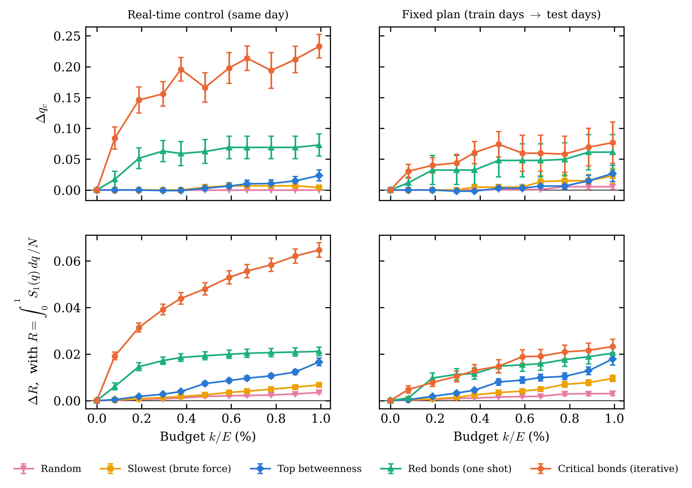
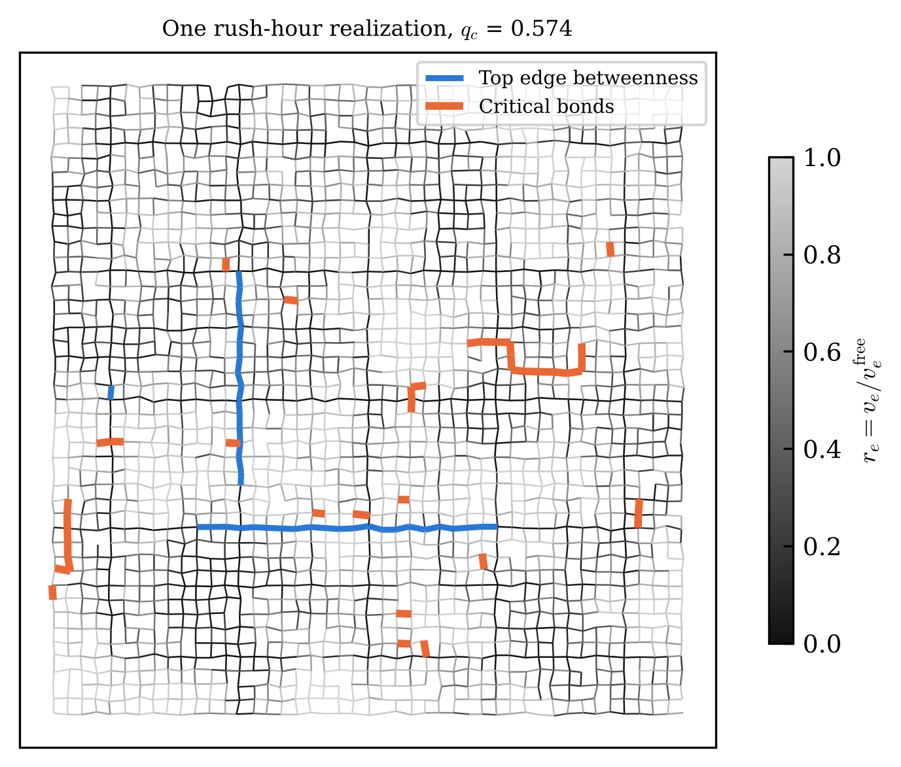

# Transições de Fase de Percolação Dinâmica e Gargalos Críticos na Malha Viária de Fortaleza

Protótipo de pesquisa em física estatística de redes complexas aplicada ao trânsito urbano.
Ponto de partida: o protocolo de percolação de tráfego de Li *et al.* (PNAS **112**, 669, 2015), adaptado para uma pergunta de **otimização**:

> Se a cidade só pode intervir em **menos de 1% das vias** (semáforo, faixa exclusiva, fiscalização), **quais** vias escolher para que a malha continue conectada mesmo exigindo velocidades altas?

**Ideia central.** Cada via $e$ tem velocidade relativa $r_e = v_e/v_e^{\rm livre}$. No nível de exigência $q$, a via está aberta se $r_e \ge q$. Subindo $q$, o componente gigante $S_1(q)$ colapsa em $q_c$, onde o segundo maior cluster $S_2(q)$ tem seu pico. Quanto **maior** $q_c$, mais resiliente é a cidade. No ponto crítico o cluster gigante é segurado por poucas *red bonds*, e são elas que devem ser consertadas.

---

## Índice Mestre do Projeto

| Frente | Entregável | Status |
|---|---|---|
| **1. Pipeline computacional** | 1.1 Extração da malha (OSM, corredor Benfica–Centro–Aldeota) | ✅ em `codigo/otimizacao_antes_depois.py` |
| | 1.2 Modelo estocástico de velocidades no rush (BPR + carga ~ betweenness + desordem congelada e recozida, espacialmente correlacionada) | ✅ |
| | 1.3 Varredura de percolação: $S_1(q)$, $S_2(q)$, $q_c$ exato (Newman–Ziff) e robustez $R$ | ✅ |
| | 1.4 Caçador de red bonds vs. edge betweenness | ✅ |
| | 1.5 Intervenção "antes vs. depois" (5 estratégias, tempo real e plano fixo) | ✅ |
| | 1.6 Análise de tamanho finito (vários recortes / tamanhos $L$) | ⏳ próximo módulo |
| | 1.7 Percolação em dígrafo (componentes fortemente conexos, mão única) | ⏳ |
| **2. Artigo (preprint)** | *Percolation-Driven Bottleneck Optimization in Urban Traffic Networks: A Case Study in Fortaleza* (revtex4-2, 4–5 p.) | ⏳ |
| **3. Handouts** | [Handout 1: Percolação, $p_c$, expoentes críticos, $S_2$, red bonds](handouts/handout01_percolacao.md) | ✅ |
| | Handout 2: Teoria espectral, funções geradoras, Molloy–Reed, matriz de Hashimoto | ⏳ |
| | Handout 3: $k$-cores, betweenness e controle de transições em malhas urbanas | ⏳ |
| **4. Sabatina** | Duas perguntas no estilo do Prof. José Soares ao fim de cada módulo | em andamento |

---

## Como rodar

```bash
pip install -r requirements.txt
python codigo/teste_algoritmos.py              # confere os algoritmos contra força bruta
python codigo/otimizacao_antes_depois.py       # malha real de Fortaleza (precisa de internet)
python codigo/otimizacao_antes_depois.py --sintetico   # malha sintética, sem internet (~40 s)
```

Opções: `--dias` (realizações do rush, padrão 40), `--orcamento` (fração máxima de vias destravadas, padrão 0,01), `--semente`.

Na primeira execução com internet, a malha do OpenStreetMap é baixada e guardada em `dados/` (cache). As figuras vão para `figuras/`, com prefixo `fortaleza_` ou `sintetico_`.

## Estrutura

```
codigo/
  otimizacao_antes_depois.py   pipeline completo (seções 0-7, comentadas)
  teste_algoritmos.py          testes contra força bruta
handouts/
  handout01_percolacao.md      teoria + deduções guiadas + problemas + gabarito
figuras/                       saídas do script
dados/                         cache da malha OSM (não versionado)
```

## O modelo em 6 equações

1. Fluxo livre: $t_e^0 = \ell_e / v_e^{\rm CTB}$ (velocidades do Código de Trânsito: 60 arterial, 40 coletora, 30 local).
2. Carga estrutural: $b_e$ = edge betweenness com pesos $t_e^0$, normalizada para $\langle b \rangle = 1$.
3. Carga no rush: $x_e = D\,(x_0 + b_e/c_e)\,\exp(\sigma_e \eta_e - \sigma_e^2/2)$, com $\sigma_e = \sigma(1 + \kappa\,\mathbb{1}_{\rm arterial})$.
4. Ruído: $\eta_e = \sqrt{\psi}\,\eta_e^{\rm crônico} + \sqrt{1-\psi}\,\eta_e^{\rm dia}$, cada parte um campo gaussiano suavizado por difusão na rede.
5. Velocidade (função BPR): $r_e = 1/(1 + \alpha x_e^{\beta})$, com $\alpha = 0{,}15$, $\beta = 4$.
6. Percolação: aberta se $r_e \ge q$; $q_c = \arg\max_q S_2(q)$; $R = \int_0^1 S_1(q)\,dq / N$.

## Resultado na malha sintética (45×45, 40 dias, orçamento de 1% = 37 vias)

> Números da **malha sintética** de teste. Os números de Fortaleza saem ao rodar o script com internet.

| Estratégia | $\Delta q_c$ tempo real | $\Delta R$ tempo real | $\Delta R$ plano fixo |
|---|---|---|---|
| Aleatória | +0,000 ± 0,000 | +0,0035 ± 0,0005 | +0,0030 ± 0,0009 |
| Vias mais lentas (força bruta) | +0,004 ± 0,003 | +0,0068 ± 0,0005 | +0,0095 ± 0,0013 |
| Maior edge betweenness | +0,024 ± 0,009 | +0,0166 ± 0,0017 | +0,0179 ± 0,0026 |
| Red bonds (uma vez) | +0,073 ± 0,018 | +0,0211 ± 0,0018 | +0,0204 ± 0,0030 |
| **Ligações críticas (iterativo)** | **+0,233 ± 0,019** | **+0,0647 ± 0,0031** | **+0,0233 ± 0,0031** |

(± = erro padrão da média sobre os dias.) Leitura:

- **Controle em tempo real:** destravar 1% das vias pelas ligações críticas sobe $q_c$ de ≈ 0,62 para ≈ 0,85. Isso é 10× o ganho da estratégia por betweenness e ~60× o da força bruta. Na robustez $R$, que é mais estável, a vantagem é ~4× sobre betweenness e ~10× sobre força bruta. Os gargalos de percolação **não** são as vias de maior betweenness (sobreposição de Jaccard = 0).
- **Plano fixo** (escolher com dias passados, aplicar em dias novos): a vantagem cai muito: em $R$ as ligações críticas ficam empatadas com betweenness e red bonds dentro do erro (ainda ~2,5× melhores que a força bruta). Os gargalos mudam de um dia para o outro (Jaccard dia a dia ≈ 0,02), exatamente o fenômeno de *evolving critical bottlenecks* de Li *et al.* Implicação prática: o ganho grande exige **controle semafórico adaptativo** (CTAFOR/AMC), não obras fixas.






## Limitações conhecidas (e próximos passos)

- Grafo **não-direcionado** (conectividade fraca). Mão única exige componentes fortemente conexos (Frente 1.7).
- A carga vem do betweenness em fluxo livre, sem reroteamento dinâmico (sem equilíbrio de Wardrop).
- As velocidades são **sintéticas**. O próximo salto é calibrar com dados reais de velocidade (p.ex. GPS de ônibus da Etufor ou dados da AMC).
- $q_c$ de uma única amostra não é monótono sob melhorias (ver Handout 1, P4); por isso reportamos também $R$.

## Referências principais

- D. Li *et al.*, PNAS **112**, 669 (2015).
- C. M. Schneider, A. A. Moreira, J. S. Andrade Jr., S. Havlin, H. J. Herrmann, PNAS **108**, 3838 (2011).
- M. E. J. Newman & R. M. Ziff, Phys. Rev. Lett. **85**, 4104 (2000).
- D. Stauffer & A. Aharony, *Introduction to Percolation Theory* (1994).
